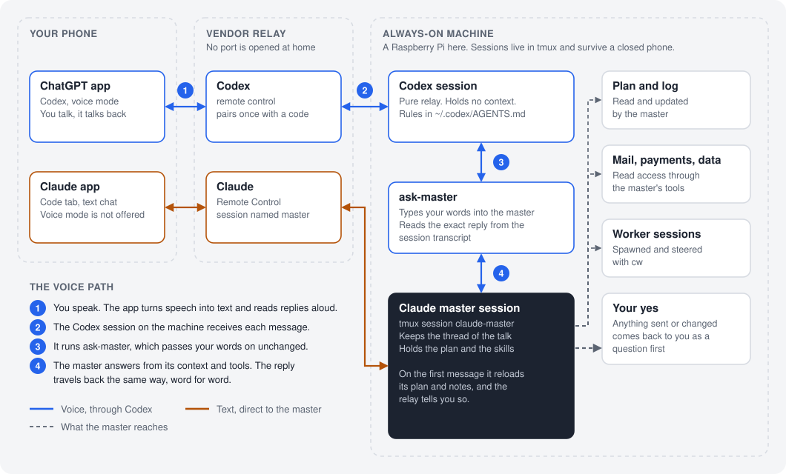
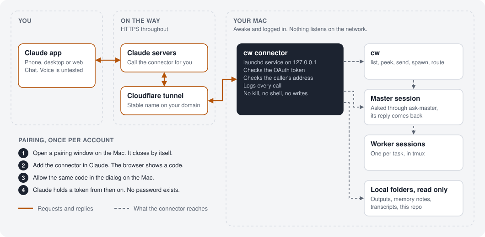

# cw orchestrator

Run many Claude Code sessions at once, each loaded with the right context for the job, and steer them from one place.

Two small bash utilities on top of tmux and the Claude Code CLI:

- **claude-ws** launches Claude Code with a workspace profile: its own MCP servers (for example a Google account per workspace), an extra CLAUDE.md layer, and environment variables. One profile per area of your life or business.
- **cw** sits above it. You type a task, a Claude agent decides which workspace fits, and the session spawns as a tmux window. You get a list view of every running session, a master chat that manages the others, and a two pane control room.

There is no API key anywhere in this setup. The routing agent is `claude -p` on your normal Claude login. Everything else is plain tmux and text files.

The full design, with diagrams and the reasoning behind each decision, is in [docs/cw-orchestrator-design.html](docs/cw-orchestrator-design.html). Open it in a browser.

## What using it looks like

```
$ cw "reply to the parent email about the schedule"
cw: routing to school (confidence 0.94). Enter to accept, or type the right workspace:
# you land in a Claude Code session, already working, with the school profile loaded

$ cw ls
ID   WS          TITLE                      STATE  AGE   TASK
0    -           master                     idle   2h    orchestrate the sub sessions
1    personal    book-a-dentist             input  4m    book a dentist appointment
2    work        draft-the-invoice          busy   1m    draft the March invoice

$ cw send 1 "Thursday 14:00"     # answer a waiting session without attaching
$ cw home                        # the control room: list left, live chat right
```

## Requirements

- macOS (tested on Apple Silicon; the scripts assume Homebrew paths)
- [Claude Code CLI](https://claude.com/claude-code), logged in
- `tmux`, `fzf`, `jq` (`brew install tmux fzf jq`), `curl`

## Install

Two ways.

**Let Claude do it.** Clone the repo, start `claude` inside it, and say "follow setup.md". The [setup.md](setup.md) skill walks Claude through dependencies, installation, building your workspace profiles interactively, and smoke testing the result.

**Do it yourself.**

```
git clone https://github.com/cameronweibel/cw-orchestrator.git
cd cw-orchestrator
./install.sh
```

The installer copies the two scripts into `~/.claude/bin`, seeds the config files it needs (never overwriting existing ones), and tells you what is left to do by hand:

1. **Profiles.** One `<name>.mcp.json` per workspace in `~/.claude/profiles/`. The file name is the workspace name. Each file lists the MCP servers that workspace may use (see `templates/example.mcp.json`). claude-ws launches with `--strict-mcp-config`, so a session sees only its own workspace's servers. This is the whole point: a "work" session can only touch the work account.
2. **Descriptions.** Give each workspace one line in `~/.claude/workspaces.json` and a section in `~/.claude/orchestrator/routing.md`. The routing agent reads both. Plain language, no syntax.
3. **Optional per workspace context.** `~/.claude/workspaces/<name>/CLAUDE.md` is appended to that workspace's system prompt, and `workspace.env` pins environment variables.

Then try it:

```
cw route "some task you would type"   # dry run, shows the routing decision
cw "that task"                        # spawn and attach
cw home                               # the control room
```

## Command reference

```
cw "task"                 route to a workspace, spawn in tmux, attach
cw -d "task"              same but stay detached
cw <ws> "task"            explicit workspace, skip routing
cw -p "task"              route, run headless (claude -p), print result
cw ls                     list all spawned sessions
cw ui                     arrow key picker with live preview, Enter attaches
cw a [id]                 attach to a session
cw peek <id> [lines]      show the last lines of a session's screen
cw send <id> "text"       type into a session and press Enter
cw kill <id>              close a session window
cw route "task"           dry run, print the routing decision
cw master                 the orchestrator chat that manages the sub sessions
cw home                   the control room: session list left, chat right
```

Session states: `busy` (the model is working), `input` (it stopped on a permission prompt or picker and needs a human), `idle` (ready for a prompt), `done` (exited).

## How routing works

1. If the first word is a workspace name or unique prefix, that workspace is used. No call of any kind.
2. Otherwise `claude -p` (a fast model, your login, no MCP loaded) reads `~/.claude/orchestrator/routing.md` plus the workspace descriptions and returns a workspace with a confidence. At 0.7 or higher it proceeds; below that it asks you.
3. On interactive spawns cw echoes the pick and pauses a few seconds. Press Enter or wait to accept, or type the right workspace to correct it. A correction makes cw ask for the general rule and write it into routing.md itself, so the router learns from every mistake.

Every decision is logged to `~/.claude/orchestrator/routing.log`.

## The master and the home screen

`cw master` opens a Claude session with no MCP servers and preapproved access to the `cw` and `tmux` commands. Talk to it in plain language: "what is everyone doing", "tell session 2 to also check Friday", "spawn a session to draft the invoice", "clean up the done sessions". It peeks before and after every send to confirm instructions landed.

`cw home` is the always on control room: a 44 column list pane on the left (live states, refreshed every few seconds, a star on the chat currently open) and the selected session filling the rest of the screen as a normal Claude Code terminal. Arrow keys move the highlight, Enter opens the highlighted chat, `m` jumps to the master, `n` spawns a new routed task, `x` kills the highlighted session (refused while busy), ctrl+t hops focus between list and chat, and the mouse works. Close the terminal and nothing dies; `cw home` reattaches.

## Voice from your phone

Claude Code has no voice mode, and the Claude app's voice mode does not reach a Remote Control session. The ChatGPT app does offer voice inside a Codex session on a paired computer. So the voice path runs through Codex, and Codex passes every message to the Claude master session.



The pieces on the always-on machine:

- **The master session** runs in tmux under a fixed session id, started with `claude --remote-control master`. You can also reach it by text from the Claude app.
- **`ask-master`** sends one message to that session and prints its reply. It types with `tmux send-keys` and reads the answer from the session transcript, so the text is exact. `ask-master --load` asks the master to re-read its plan and notes, `--voice` marks a turn as spoken, `--last` fetches a reply that took longer than the wait, `--status` prints busy or idle.
- **The Codex session** is a pure relay. Append `templates/voice-relay.md` to `~/.codex/AGENTS.md` on that machine. On the first message of a conversation it says it is loading your context from the master session, runs `ask-master --load`, and then relays every turn.

Setup on the machine:

```bash
npm i -g @openai/codex && codex login --device-auth
cp bin/ask-master ~/.claude/bin/ && chmod +x ~/.claude/bin/ask-master
cat templates/voice-relay.md >> ~/.codex/AGENTS.md
echo "<the master's session id>" > ~/.claude/orchestrator/master.sid
codex remote-control start -c sandbox_mode='"danger-full-access"' -c approval_policy='"never"'
codex remote-control pair     # enter the code in the ChatGPT app, once
```

The relay runs without a sandbox because it has to reach tmux and the transcript. Its instructions limit it to `ask-master`, which is a rule the model follows and no hard lock. The master still asks before anything is sent or changed, and the relay puts that question to you.

## The cw connector for the Claude apps

`connector/` holds a remote MCP server that you add to Claude as a custom connector. Claude on the phone, desktop or web can then list, peek at, instruct and start cw sessions on your Mac, ask the master session, and read past outputs and transcripts. It is locked with OAuth and a pairing step on the Mac, and it has no kill, shell or write tool. Setup and the security model are in [connector/README.md](connector/README.md).



## Files

```
~/.claude/bin/cw                       the orchestrator
~/.claude/bin/claude-ws                the workspace launcher
~/.claude/profiles/<ws>.mcp.json       one MCP profile per workspace
~/.claude/workspaces/<ws>/CLAUDE.md    optional extra context per workspace
~/.claude/workspaces/<ws>/workspace.env  optional env vars per workspace
~/.claude/workspaces.json              workspace registry with descriptions
~/.claude/orchestrator/routing.md      plain language routing rules
~/.claude/orchestrator/routing.log     every routing decision
~/.claude/orchestrator/master.md       the master session's instructions
~/.claude/bin/ask-master               relay one message to the master, print its reply
~/.claude/orchestrator/master.sid      the master's session id, read by ask-master
~/.claude/orchestrator/voice-load.md   optional text that ask-master --load sends
```

## Troubleshooting

- **Routing feels wrong.** Add the misrouted phrasing to the right section of `routing.md`, or let the correction prompt do it for you. Check `routing.log` to see what the router thought.
- **`cw home` list stuck or empty.** The list pane restarts cleanly: from any terminal run `tmux -L cwhome kill-server` and then `cw home` again. Running sessions live on the default tmux server and are not affected.
- **Sessions gone after reboot.** tmux does not survive reboots. Sessions are cheap to respawn; `claude --resume` inside a workspace recovers a conversation if needed.
- **Intel Mac or Linux.** The scripts reference `/opt/homebrew/bin` in a few places; adjust to your paths.
