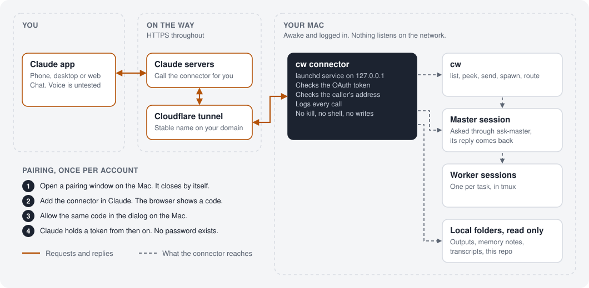

# cw connector

A remote MCP server that lets the Claude apps drive cw on your Mac. Add it once as a custom connector and it is available on web, desktop and phone.



## What Claude can do through it

| Tool | What it does |
|---|---|
| `list_sessions` | `cw ls` |
| `peek_session` | the last lines on one session's screen |
| `send_to_session` | types a message into one session and presses Enter |
| `route_task` | dry run of the router |
| `spawn_session` | starts a session in a named workspace, or routes the task first |
| `ask_master` | sends a message to the master session and returns its reply |
| `master_last_reply` | fetches a reply that took longer than the wait |
| `list_local`, `search_local`, `read_local` | read-only access to the folders named in `config.json` |

It has no kill, no shell and no file write. Keep in mind that `send_to_session` and `ask_master` type into sessions that can run commands, so a paired client has the reach of those sessions.

## How access is locked

- **OAuth 2.1 with PKCE and dynamic client registration**, which is what Claude custom connectors use. Registration accepts Claude's callback address only.
- **No password.** A new client is accepted only while a pairing window is open on the Mac (`cw_connector.py pair`), and only after you allow the code shown in the browser, in a dialog on the Mac or with `cw_connector.py approve CODE`. One approval closes the window.
- **Address filter.** The machine endpoints (`/mcp`, `/register`, `/token`) answer only to the address range Anthropic documents for connector traffic. Everyone else gets a 403.
- **The server listens on 127.0.0.1.** The tunnel is the only way in, and it carries HTTPS.
- **Read access is fenced.** Paths are resolved first, so a symlink cannot leave the configured folders. Files with names such as `.env`, keys, tokens and credentials are never read, and common key formats are masked in output.
- **Tokens are stored as hashes** in `state.json`, mode 600. Access tokens last one hour. Refresh tokens rotate.
- **Every tool call is written** to `audit.log`.

## Setup

```bash
mkdir -p ~/.claude/cw-connector && cd ~/.claude/cw-connector
uv venv --python 3.12 venv && uv pip install --python venv/bin/python "mcp>=2,<3" uvicorn
cp <repo>/connector/cw_connector.py <repo>/connector/smoke_test.py .
cp <repo>/connector/config.example.json config.json     # set public_url and the folders
cp <repo>/bin/ask-master ~/.claude/bin/
```

Expose it with a Cloudflare tunnel of its own:

```bash
brew install cloudflared
cloudflared tunnel login
cloudflared tunnel create cw-mac
cloudflared tunnel route dns <tunnel id> cw.example.com
```

Write `~/.claude/cw-connector/tunnel/config.yml`:

```yaml
tunnel: <tunnel id>
credentials-file: /Users/you/.claude/cw-connector/tunnel/<tunnel id>.json
ingress:
  - hostname: cw.example.com
    service: http://127.0.0.1:8787
  - service: http_status:404
```

Then install the two launchd agents from the `.plist.example` files and load them with `launchctl bootstrap gui/$(id -u) <file>`.

A Cloudflare tunnel was chosen over Tailscale Funnel because it runs as a plain daemon that reconnects by itself, keeps a stable name on your own domain, and does not depend on a desktop app staying signed in.

## Pair a Claude account

1. On the Mac: `~/.claude/cw-connector/venv/bin/python ~/.claude/cw-connector/cw_connector.py pair`
2. In Claude on the web: Plugins, Add, Add custom connector. Name it and enter `https://cw.example.com/mcp`. Keep "Sign in now" and "Register automatically". Select Add.
3. The browser shows a code. Allow the dialog on the Mac if the code matches.

The connector then appears in the mobile apps of the same account.

## Check it

`smoke_test.py https://cw.example.com` runs the whole flow without a browser: refusals, pairing, PKCE, refresh, and every tool. Add your own address to `ip_allow` for the duration of the test, open a window with `pair --no-dialog`, and remove the address afterwards.

## A second machine

The same server runs on Linux. Give each machine its own host name and add each one to Claude as its own connector. In `config.json` set `machine` to the name Claude should use, and when the master does not live in window 0 of the cw tmux session, set `master_target` to its tmux target and `master_sid` to its Claude session id. Without a desktop there is no dialog, so approve a pairing with `cw_connector.py approve CODE`. Run it from a systemd user service in place of launchd.

## Limits

- The Mac has to be awake and logged in. Sessions live in tmux in your login session.
- A tool call from Claude may run up to 240 seconds. `ask_master` waits 45 seconds by default and hands back a note to call `master_last_reply` when the master needs longer.
- If Anthropic changes its address range, calls stop with a 403 that shows in `audit.log` as `ip_refused`. Update `ip_allow`.
